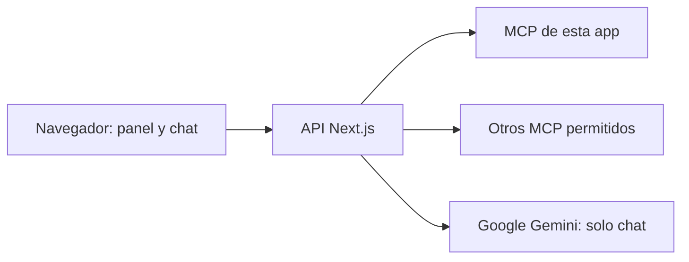

# Cómo funciona

[Módulos y comienzo rápido](../README.md)

## Tres piezas diferentes

- **Servidor MCP:** publica herramientas y valida sus argumentos. El incluido vive en `/api/mcp`.
- **Cliente MCP:** conecta con un servidor, descubre sus herramientas y las ejecuta.
- **Host:** coordina clientes y ofrece una interfaz. Aquí incluye el panel y el chat.

El endpoint incluido utiliza directamente el transporte Web Standard del SDK de MCP en modo sin sesión. Evita el adaptador HTTP de Node, que puede reemplazar los constructores globales Request/Response e interferir con Next.js.

Esta aplicación cumple los tres papeles. Un MCP remoto puede estar desarrollado con otro lenguaje o framework.

## Ejecución manual

1. El panel envía una URL a `POST /api/clients/connect`.
2. La API comprueba acceso, tamaño de solicitud y URL permitida.
3. Un cliente MCP inicializa la conexión y pagina `tools/list`.
4. El panel genera un formulario con el esquema de argumentos.
5. Al ejecutar, `POST /api/clients/call-tool` abre otra conexión y solicita `tools/call`.
6. La API conserva `isError`, `content` y `structuredContent`. Cierra la conexión al terminar o fallar.

«Conectar» comprueba disponibilidad; no mantiene una sesión compartida en el navegador. No se conserva contexto de sesión entre ejecuciones manuales.

## Chat

1. El navegador envía historial y servidores seleccionados.
2. La API valida las URLs antes de contactar cualquier servidor.
3. Abre un cliente por servidor seleccionado y obtiene sus herramientas.
4. Cada herramienta recibe un identificador estable a partir de su URL y nombre para evitar colisiones.
5. Gemini decide si debe ejecutar una herramienta. La llamada se realiza desde la API.
6. El resultado vuelve al modelo, que responde mediante streaming.
7. Al terminar, cancelar o fallar, se cierran los clientes. La respuesta admite hasta 5 pasos y tiene un límite global de 55 segundos (incluye preparar MCP).

Si un servidor seleccionado falla al prepararse, la app identifica cuál y detiene la solicitud. No lo omite silenciosamente. Una selección vacía permite conversar sin herramientas.

## Estado y privacidad

| Información               | Ubicación                       | Duración                                                      |
| ------------------------- | ------------------------------- | ------------------------------------------------------------- |
| Nombres, URLs, selección  | localStorage                    | Hasta quitarlos o borrar datos del navegador                  |
| Clave compartida del host | sessionStorage                  | Durante la sesión de la pestaña; botón «Olvidar»              |
| Mensajes                  | Memoria del componente          | Hasta recargar, cambiar selección o iniciar otra conversación |
| Claves Gemini/MCP         | Variables privadas del servidor | Según tu despliegue                                           |
| Conexiones MCP            | Servidor Next.js                | Por consulta manual o respuesta del chat                      |

No hay base de datos interna ni sincronización de listas entre dispositivos. Los MCP consultados pueden tener su propia persistencia. Google y cada servicio remoto aplican sus propias políticas de datos.
